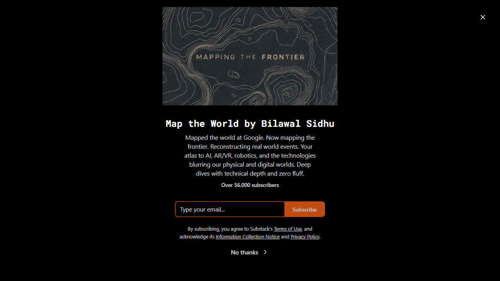

# gods-eye-view

> Fork/reference repository kept for learning and exploration.

A real-time intelligence console for planet Earth — photorealistic 3D globe, live aircraft/ships/satellites/earthquakes/CCTV, and hands-free voice control. Runs in a browser.

**Live demo:** https://maptheworld.ai/  
**Repository:** https://github.com/Chandrasen74/gods-eye-view



## Overview
This is a fork/reference copy of **gods-eye-view** in my account for study and experimentation.
- **Primary language:** JavaScript
- **Languages detected:** JavaScript, Shell, HTML, CSS
- **Stack/tech:** Node.js, Vite, HTML, CSS
- **npm scripts:** doctor, dev, dev:secure, opensky:import, build, preview, launcher, build:exe
- **Entry point:** `index.html`
- **Key files:** `index.html`, `package.json`, `pinokio/package.json`, `vite.config.js`

## Language & stack details
- Languages: JavaScript, Shell, HTML, CSS
- Frameworks/tools/libraries: Node.js, Vite, HTML, CSS

## How to install & run
### Prerequisites
- [Node.js](https://nodejs.org/) (LTS recommended)
- npm (included with Node.js)

### Setup
```bash
git clone https://github.com/Chandrasen74/gods-eye-view.git
cd gods-eye-view
npm install
```

### Run locally (development)
```bash
npm run dev
```

### Build / preview
```bash
npm run build
npm run preview
```

### Available scripts
- `npm run doctor`
- `npm run dev`
- `npm run dev:secure`
- `npm run opensky:import`
- `npm run build`
- `npm run preview`
- `npm run launcher`
- `npm run build:exe`
- `npm run build:exe:local`
- `npm run test`

## Repository structure (top-level/sample)
- `.env.example`
- `.gitattributes`
- `.github/CODEOWNERS`
- `.github/workflows/build-windows-exe.yml`
- `.github/workflows/ci.yml`
- `.gitignore`
- `CHANGELOG.md`
- `CONTRIBUTING.md`
- `DATA_SOURCES.md`
- `LICENSE`
- `README.md`
- `SECURITY.md`
- `TESTING.md`
- `config/cctv_sources.austin.json`
- `config/cctv_sources.shinjuku.json`
- `docs/CURRENT-STATE.md`
- `docs/KNOWN-ISSUES.md`
- `docs/PERFORMANCE.md`
- `docs/WINDOWS_EXE.md`
- `docs/media/01-style-sweep.gif`
- `docs/media/01-voice-annotate-zilker.gif`
- `docs/media/03-austin-cctv.gif`
- `docs/media/04-airport-distance.gif`
- `docs/media/05-traffic-to-cctv.gif`
- `docs/media/06-cockpit-ar.gif`
- `docs/media/07-helicopter-loops.gif`
- `docs/media/08-boneyard.gif`
- `docs/media/08-falcon9-replay.gif`
- `docs/media/09-undersea-cables.gif`
- `docs/media/10-walking-route-flythrough.gif`
- `docs/media/12-switch-aircraft-cockpit.gif`
- `docs/media/14-iss-over-ukraine.gif`
- `docs/media/15-global-radio-layer.gif`
- `docs/media/README.md`
- `docs/media/hero-open-source-reveal.gif`
- `docs/media/open-source-survey.png`
- `docs/media/start-here/airport-ground-traffic-google-3d.gif`
- `docs/media/start-here/military-cockpit-dense-google-3d.gif`
- `docs/media/youtube-popular-videos.png`
- `docs/opensky-auth.md`
- ... and 418 more file(s)

## Notes
- Fork/reference repository; check upstream for canonical source and license details.

## Status
Documented with screenshot, language/stack details, and setup instructions as part of a profile-wide README update.
